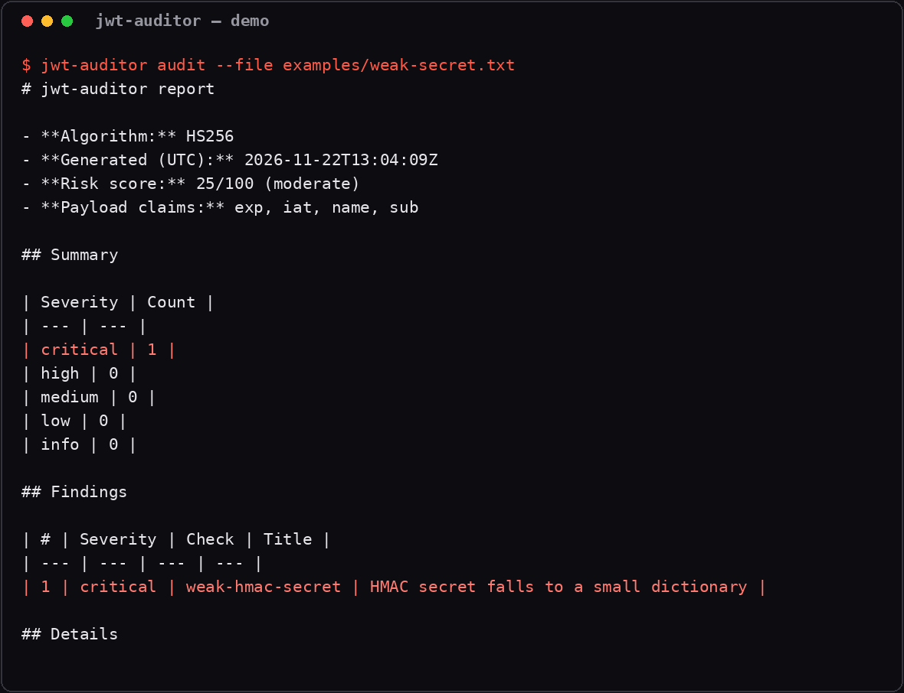

# jwt-auditor

[](https://www.python.org/)
[](LICENSE)
[](https://codecov.io/gh/gravion-ux/jwt-auditor)
[](https://github.com/gravion-ux/jwt-auditor/actions/workflows/ci.yml)
[](#installation)

> **Status: Active** — maintained flagship. The auditor remains offline
> and defensive by design; new checks must preserve that boundary.



*Demo: Auditing a token signed with a weak secret, from the bundled examples.*

**Audit a JSON Web Token for the weaknesses that actually get exploited — before someone else finds them.**

`jwt-auditor` is a small, dependency-free Python CLI that decodes a JWT and
checks it against the failure modes seen in real assessments and CVEs:
`alg=none`, empty signatures, HMAC secrets that fall to a small dictionary,
tokens that carry their own key material (`jwk`/`jku`/`x5u`/`x5c`), injectable
`kid` values, duplicate JSON keys, missing or excessive expiry, and sensitive
data sitting in the (only base64-encoded) payload. It produces a prioritised
report — Markdown for humans, JSON for pipelines — with a 0–100 risk score.

It is a **defensive, authorised-testing tool**: fully offline, no network
calls, nothing is sent anywhere. See [Authorised use & ethics](#authorised-use--ethics).

---

## Features

- **Algorithm checks** — `alg=none` (critical), missing `alg`, and empty
  signature segments on signed algorithms.
- **Weak-secret dictionary** — HS256/HS384/HS512 signatures are tested
  against a built-in list of ~50 secrets that recur in tutorials, defaults
  and leaked code (`secret`, `your-256-bit-secret`, `changeme`, …), plus
  your own `--wordlist` for engagement-specific candidates. A hit is
  critical: anyone can mint arbitrary claims.
- **Key-confusion surface** — embedded/referenced key material
  (`jwk`, `jku`, `x5u`, `x5c`) and `kid` values containing path-traversal
  or injection metacharacters.
- **Parser-differential checks** — duplicate keys in header or payload,
  which different JSON parsers resolve differently.
- **Lifetime hygiene** — missing `exp`, already-expired tokens, lifetimes
  over 30 days, `nbf` in the future.
- **Claim hygiene** — payload keys that look like passwords, tokens, card
  numbers or government IDs (a JWT payload is readable by anyone holding it).
- **CI-friendly** — exit `1` when findings reach the `--fail-on` severity
  (default `high`), `0` when clean, `2` on usage errors / malformed tokens.
- **Zero runtime dependencies** — Python standard library only.
- **Tested** — 38 pytest tests covering decoding, every check family, the
  dictionary attack, and the CLI end to end.

## Requirements

- **Python 3.9 or newer** (`requires-python = ">=3.9"`; CI tests
  3.10, 3.11 and 3.12).
- **No runtime dependencies** — Python standard library only, and the
  auditor works fully offline: no network calls, nothing is sent
  anywhere.
- **For development / the test suite:** `pip install -e ".[dev]"`
  (adds `pytest` and `pytest-cov`).

## Installation

Requires Python 3.9 or newer.

```bash
git clone https://github.com/gravion-ux/jwt-auditor.git
cd jwt-auditor
pip install -e .
```

For development (adds pytest):

```bash
pip install -e ".[dev]"
```

No installation is strictly required:

```bash
PYTHONPATH=src python3 -m jwt_auditor audit <token>
```

## Quick start

Audit the bundled example tokens — one weak-secret token, one healthy
token:

```bash
pip install -e .
jwt-auditor audit --file examples/weak-secret.txt   # -> critical finding, exit 1
jwt-auditor audit --file examples/healthy.txt       # -> no findings, exit 0
```

## Usage

### Audit a token

```bash
jwt-auditor audit eyJhbGciOiJIUzI1NiIsInR5cCI6IkpXVCJ9...
jwt-auditor audit --file token.txt
cat token.txt | jwt-auditor audit -
jwt-auditor audit --file token.txt --format json --output report.json
jwt-auditor audit --file token.txt --wordlist rockyou-top1000.txt
```

Try it on the bundled examples:

```bash
$ jwt-auditor audit --file examples/weak-secret.txt
# jwt-auditor report
- **Algorithm:** HS256
- **Risk score:** 25/100 (moderate)
| critical | 1 |
### 1. [CRITICAL] HMAC secret falls to a small dictionary
- **Detail:** The HS256 signature verifies with the well-known secret
  'secret'. Anyone can now mint tokens with arbitrary claims for this issuer.

$ jwt-auditor audit --file examples/alg-none.txt   # -> critical alg-none
$ jwt-auditor audit --file examples/healthy.txt    # -> No findings, exit 0
$ jwt-auditor audit --file examples/kid-injection.txt   # -> medium kid-injection-pattern
$ jwt-auditor audit --file examples/duplicate-keys.txt  # -> medium duplicate-json-keys
```

The last two examples are synthetic HS256 tokens, signed with the public
demo-only key `synthetic-example-key-not-for-production`. Both use the fake
issuer `https://issuer.example.invalid` and subject `synthetic-demo-user`.
The first puts `../../dev/null` in the `kid` header; the second contains
two `role` claims (`reader` and `editor`) in its raw payload JSON.
They are static audit fixtures, not credentials for any service. Their
fixed `exp` timestamps may eventually add a low-severity `token-expired`
finding; the intended medium-severity finding remains visible.

Medium findings do not fail the default `high` threshold (exit `0`). To
make either example fail a CI check, set `--fail-on medium` (exit `1`):

```bash
jwt-auditor audit --file examples/kid-injection.txt --fail-on medium
jwt-auditor audit --file examples/duplicate-keys.txt --fail-on medium
```

### Just decode

```bash
jwt-auditor decode --file token.txt
```

Prints the header and payload as JSON plus the signature length. Accepts a
raw token or an `Authorization: Bearer …` value.

### Exit codes

| Code | Meaning |
| --- | --- |
| `0` | No findings at or above the `--fail-on` severity (default: `high`) |
| `1` | Findings at or above the threshold — CI should fail |
| `2` | Usage / input error, including a malformed token |

## Limitations — what it does not do

- It does **not** verify tokens against an issuer's real keys (except the
  weak-secret dictionary) — it audits token hygiene, it is not a JWT library.
- It does **not** implement RS256→HS256 confusion forging or any other
  exploitation; findings describe the exposure and the fix.
- A clean report is not proof a token system is secure — key storage,
  verifier configuration and claim validation still need review.
- The dictionary attack covers the built-in list of ~50 known-weak
  secrets plus any `--wordlist` you supply. A secret outside those
  lists will not be found — that is expected, not a pass.

## Authorised use & ethics

Only audit tokens from systems you own or are explicitly authorised to
test. A cracked signing secret is a critical finding: report it to the
system owner through the proper channel, rotate it, and do not use it to
access anything beyond what your authorisation covers.

## Development

```bash
pip install pytest pytest-cov
python -m pytest -q --cov=jwt_auditor --cov-fail-under=85  # 38 tests
```

## Sponsors

Sponsorship pays for the maintenance, triage and release time behind this tool. Sponsors are
listed here by name, and name placement starts at the $25 a month Sponsor tier or the $50
one-time Sponsor tier.

- [Sponsor on GitHub](https://github.com/sponsors/gravion-ux)

## License

MIT — see [LICENSE](LICENSE).
